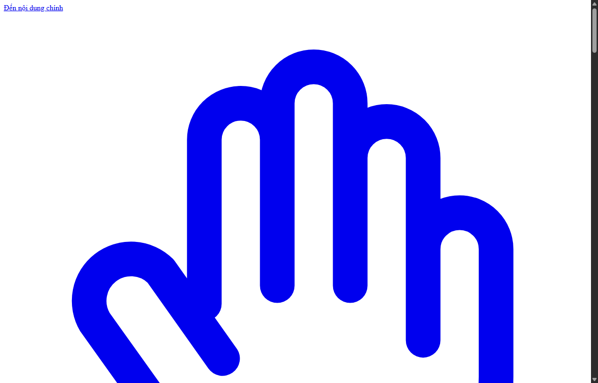
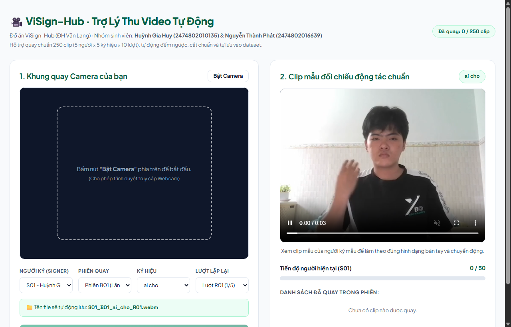

# ViSign-Hub: Hệ thống Nhận diện Ngôn ngữ Ký hiệu Việt Nam từ Video

Ứng dụng đồ án nhận diện 5 ký hiệu ngôn ngữ ký hiệu Việt Nam từ video bằng MediaPipe Holistic kết hợp mô hình học sâu TCN và MLP.

Phạm vi 5 từ ký hiệu hỗ trợ: **ai cho**, **bực mình**, **ghen tị**, **không cần**, **xin lỗi**.

### Nhóm sinh viên thực hiện (Trường Đại học Văn Lang)
- **Huỳnh Gia Huy** — MSSV: `2474802010135`
- **Nguyễn Thành Phát** — MSSV: `2474802016639`

---

## Giao diện Ứng dụng

| Giao diện Nhận diện Ký hiệu (Web Demo) | Studio Thu Video Tự động |
| :---: | :---: |
|  |  |

---

> [!NOTE]
> **Tóm tắt cập nhật kỹ thuật:**
> - **Bộ dữ liệu thực tế:** 20 video clips từ 3 người ký (`giahuy`: 8, `huy1`: 6, `minh`: 6) cho 5 từ ký hiệu mục tiêu.
> - **Độ chính xác trên tập học:** Đạt 20/20 (100.0%) trên 20 clip huấn luyện (*training set replay / empirical fitting*) với điểm số softmax đạt mức 0.97 – 0.99 do mô hình đã học trực tiếp trên các mẫu này.
> - **Kiểm chứng liên người ký (Leave-One-Signer-Out / LOSO):** Khi kiểm thử mù độc lập trên người ký chưa từng học (`research/loso_check.py`), kết quả Top-1 thực tế đạt **TCN 63.3%** và **MLP 66.7%**, phản ánh sự suy giảm tự nhiên khi mô hình đối mặt với người ký mới lạ do khác biệt về vóc dáng và tốc độ thực hiện.
> - **Đánh giá ngoài bộ từ (OOV):** Thử nghiệm trên 29 clips cử chỉ ngoài phạm vi từ 2 người ký (`giahuy`: 17, `tp`: 12). TCN gốc có tỷ lệ nhận nhầm 21/29 (72.4%), MLP là 9/29 (31.0%). Checkpoint TCN có từ chối (`tcn_reject`) chặn 29/29 clips OOV này do đã học trên đúng 29 clips đó, đồng thời từ chối nhầm 11/20 clip hợp lệ của người ký mới.
> - **Cập nhật tầng phân loại bằng NumPy Adam:** Tinh chỉnh 2 lớp phân loại cuối của TCN bằng bộ tối ưu Adam thuần NumPy (không cần JAX khi chạy suy luận), trong khi các tầng tích chập thời gian kế thừa từ checkpoint nền tảng.
> - **Studio thu video:** Bổ sung giao diện Web Studio quay trực tiếp từ camera với đếm ngược 3-2-1 và lưu tự động vào `data/clips_moi/`.

---

## 1. Phân bố dữ liệu thực nghiệm

### A. Dữ liệu trong bộ từ (In-Vocabulary: 20 clips)
| Từ ký hiệu | giahuy | huy1 | minh | Tổng số clip | Tỷ lệ thấy tay TB |
| :--- | :---: | :---: | :---: | :---: | :---: |
| **ai cho** | 3 | 1 | 1 | **5** | 0.78 |
| **bực mình** | 1 | 1 | 1 | **3** | 0.82 |
| **ghen tị** | 1 | 1 | 1 | **3** | 0.79 |
| **không cần** | 2 | 1 | 2 | **5** | 0.85 |
| **xin lỗi** | 1 | 2 | 1 | **4** | 0.81 |
| **Tổng cộng** | **8** | **6** | **6** | **20** | **0.81** |

### B. Dữ liệu ngoài bộ từ (Out-of-Vocabulary: 29 clips)
Gồm 29 video clips thực hiện 29 cử chỉ khác biệt (*bối rối, không cho, không nên, khuyến khích, kỹ năng, nấu nướng, tinh mắt, may mắn, tự giác...*) từ 2 người ký: `giahuy` (17 clips) và `tp` (Nguyễn Thành Phát: 12 clips).

---

## 2. Kết quả đánh giá thực nghiệm

Chạy kiểm chứng độc lập bằng lệnh:
```powershell
python tools/danh_gia_thuc_nghiem.py
```

### Bảng 1: Đánh giá trên 20 clips thực tế (In-Vocabulary)
| Mô hình | Số clips | Top-1 Đúng | Tỷ lệ Top-1 | Chấp nhận đúng (>=0.65) | Chấp nhận sai | Bị từ chối |
| :--- | :---: | :---: | :---: | :---: | :---: | :---: |
| **TCN gốc / TCN tăng cường** (*) | 20 | 20/20 | **100.0%** | 20/20 | 0/20 (0.0%) | 0/20 (0.0%) |
| **MLP đối chiếu** | 20 | 20/20 | **100.0%** | 20/20 | 0/20 (0.0%) | 0/20 (0.0%) |
| **TCN có từ chối** | 20 | 15/20 | **75.0%** | 9/20 | 0/20 (0.0%) | 11/20 (55.0%) |

*Lưu ý khoa học cho Bảng 1:* 
- (*) Checkpoint TCN tăng cường hiện dùng cùng bộ trọng số với TCN gốc nên cho kết quả tương đương.
- Kết quả 100% của TCN và MLP là trên **tập học** (*training set replay / empirical fitting*). Điểm tự tin softmax đạt mức 0.97 – 0.99 do mô hình đã trực tiếp tối ưu hóa trên các mẫu này.
- Mô hình TCN có từ chối (`tcn_reject`) từ chối nhầm 11/20 clips hợp lệ (chủ yếu là clips của `huy1` và `minh`) do checkpoint này được huấn luyện trước trên dữ liệu lịch sử và chưa được học lại trên 12 clips mới.

### Bảng 2: Đánh giá khả năng từ chối trên 29 clips ngoài bộ từ (OOV)
| Mô hình | Số clip OOV | Nhận nhầm (False Accept) | Tỷ lệ nhận nhầm | Từ chối đúng | Tỷ lệ từ chối | Cơ chế từ chối chính |
| :--- | :---: | :---: | :---: | :---: | :---: | :--- |
| **TCN gốc / TCN tăng cường** (*) | 29 | 21/29 | **72.4%** | 8/29 | **27.6%** | Chỉ từ chối khi điểm < 0.65 |
| **MLP đối chiếu** | 29 | 9/29 | **31.0%** | 20/29 | **69.0%** | Chỉ từ chối khi điểm < 0.65 |
| **TCN có từ chối** (**) | 29 | 0/29 | **0.0%** | 29/29 | **100.0%** | Phân loại vào lớp `__OTHER__` |

*Lưu ý khoa học cho Bảng 2:*
- (*) Checkpoint TCN tăng cường hiện dùng cùng bộ trọng số với TCN gốc.
- (**) Kết quả chặn 29/29 (100.0%) của mô hình TCN có từ chối (`tcn_reject`) là do 29 clips OOV này đã nằm trong tập học của checkpoint (training replay), nên không mang giá trị chứng minh khả năng tổng quát hóa trên dữ liệu OOV chưa biết. Khi đánh giá giữ riêng nguồn độc lập (source holdout), mô hình này đạt tỷ lệ nhận nhầm ngoài bộ từ khoảng 8.0%, nhưng đánh đổi bằng việc từ chối nhầm nhiều clip hợp lệ trong bộ từ.

---

## 3. Hướng dẫn cài đặt môi trường

Yêu cầu: **Python 3.11** (khuyến nghị bản 3.11.9 64-bit).

### Bước 1: Clone mã nguồn
```bash
git clone https://github.com/WendyHuy/KyHieuLab_DoAn.git
cd KyHieuLab_DoAn
```

### Bước 2: Khởi tạo môi trường ảo (Virtual Environment)
```powershell
# Trên Windows
py -3.11 -m venv .venv
.venv\Scripts\activate

# Trên Linux / macOS
python3.11 -m venv .venv
source .venv/bin/activate
```

### Bước 3: Cài đặt các thư viện phụ thuộc
```powershell
python -m pip install --upgrade pip
pip install -r requirements.txt
```

*Các phiên bản thư viện chính:*
- `mediapipe==0.10.21` (Trích xuất toạ độ khung xương 3D)
- `opencv-contrib-python==4.11.0.86` (Xử lý khung hình video)
- `numpy==1.26.4` (Tính toán đại số tuyến tính và suy luận mạng nơ-ron)

### Bước 4: Kiểm tra trạng thái cài đặt
```powershell
python tools/doctor.py --warmup
```
*(Hoặc nhấp đúp file `KIEM_TRA_CAI_DAT.bat` trên Windows.)*

---

## 4. Hướng dẫn chạy ứng dụng và kiểm thử

### 1. Khởi chạy Ứng dụng Demo Nhận diện
Nhấp đúp chuột vào file:
```cmd
CHAY_DEMO.bat
```
Hoặc chạy dòng lệnh:
```powershell
python app.py
```
Sau đó mở trình duyệt tại địa chỉ: `http://localhost:8765` để trải nghiệm nhận diện qua webcam hoặc video mẫu.

### 2. Thu thêm Video Ký hiệu mới (Studio Quay Video)
Nhấp đúp chuột vào file:
```cmd
MO_STUDIO_QUAY_VIDEO.bat
```
- Trình duyệt sẽ mở giao diện Studio tại: `http://localhost:8767`.
- Chọn người ký, từ ký hiệu, bấm phím Cách (Spacebar) hoặc nút Quay.
- Hệ thống đếm ngược 3-2-1 kèm âm thanh, tự động quay 4.5 giây và lưu video vào thư mục `data/clips_moi/`.

### 3. Huấn luyện lại Mô hình khi bổ sung dữ liệu
Khi có thêm video mới trong `data/clips_moi/`, chạy lệnh sau để trích xuất đặc trưng và cập nhật trọng số:
```powershell
python tools/extract_new_clips.py
python tools/train_and_save_v6.py
```

### 4. Đánh giá Thực nghiệm & Kiểm thử
```powershell
# 1. Chạy bộ kiểm thử tự động (23 tests pass):
python -m unittest tests/test_project.py

# 2. Chạy script đánh giá thực nghiệm (In-Vocab & OOV):
python tools/danh_gia_thuc_nghiem.py

# 3. Chạy kiểm chứng Leave-One-Signer-Out (LOSO):
python research/loso_check.py
```

---

## 5. Cấu trúc thư mục đồ án

```text
KyHieuLab_DoAn/
├── app.py                      # Máy chủ HTTP Server & Engine suy luận
├── core.py                     # Tiền xử lý MediaPipe & suy luận thuần NumPy
├── data/                       # 20 clips thực tế, 29 clips OOV, manifest.json
├── models/                     # Trọng số .npz và cấu hình .json của các mô hình
├── reports/                    # Báo cáo Word .docx, Markdown .md và các biểu đồ
├── research/                   # Script kiểm chứng LOSO loso_check.py và nghiên cứu
├── tools/                      # Script đánh giá danh_gia_thuc_nghiem.py, doctor.py, studio
├── web/                        # Giao diện Web nhận diện (index.html, style.css, app.js)
├── docs/                       # Kịch bản báo cáo và ảnh chụp giao diện
└── tests/                      # Bộ kiểm thử hồi quy tự động test_project.py
```

---

## 6. Hồ sơ bàn giao

- `reports/Bao_cao_DoAn_KyHieuLab_v6.md` & `.docx`: Báo cáo đồ án môn học (cập nhật phân tích dữ liệu 20 clips 3 người ký và cơ chế từ chối OOV).
- `research/loso_check.py`: Script kiểm chứng Leave-One-Signer-Out (LOSO).
- `tools/danh_gia_thuc_nghiem.py`: Công cụ đánh giá thực nghiệm độc lập thuần NumPy.
- `docs/KICH_BAN_BAO_CAO.md`: Kịch bản thuyết trình bảo vệ đồ án (8-10 phút).
- `models/`: Trọng số các mô hình học sâu (`tcn`, `mlp`, `tcn_augmented`, `tcn_reject`).
